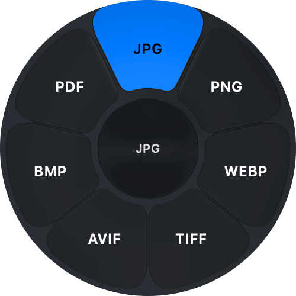
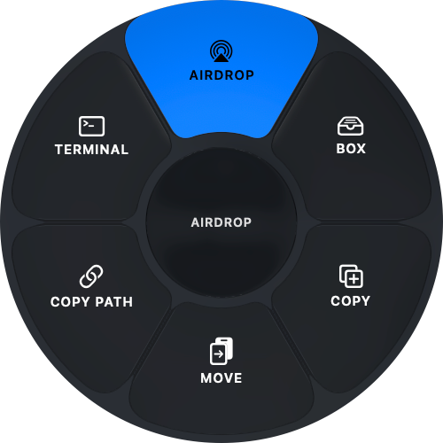
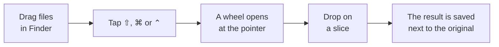
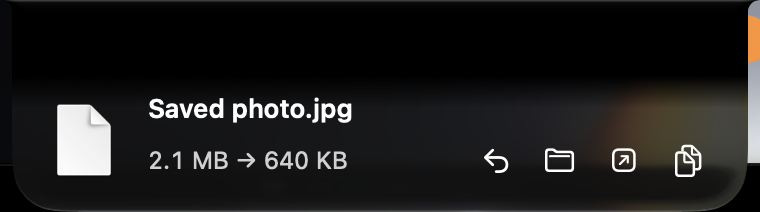
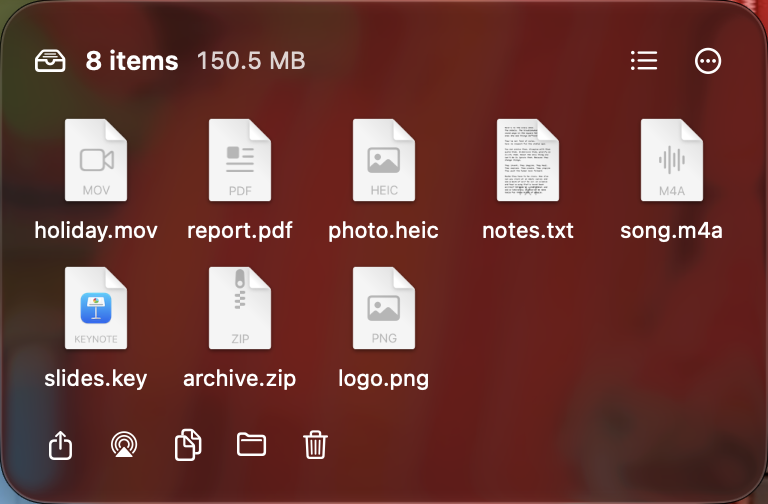
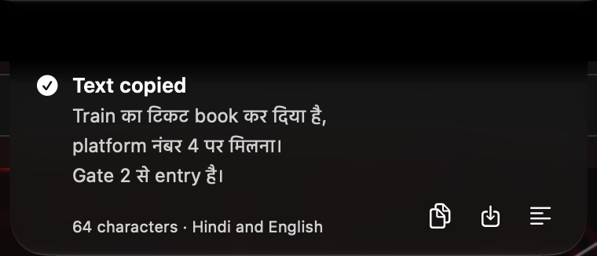
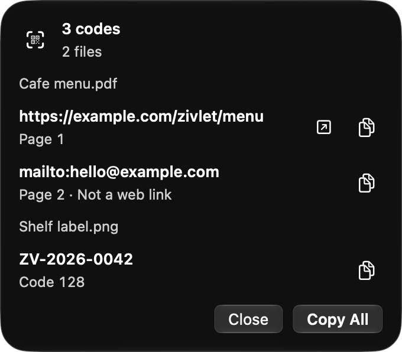
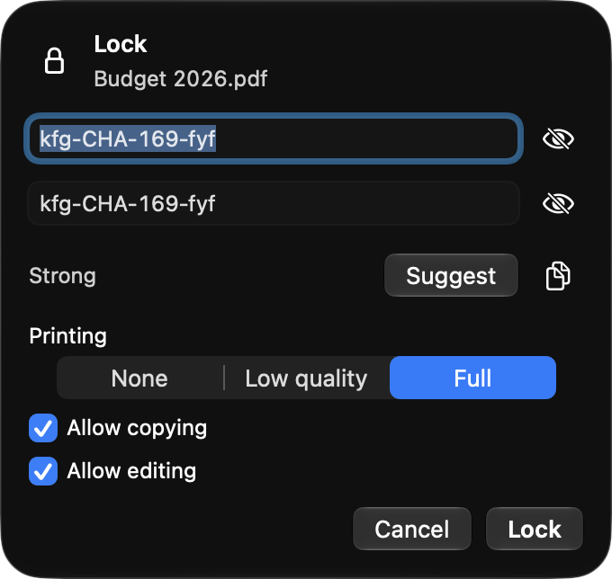
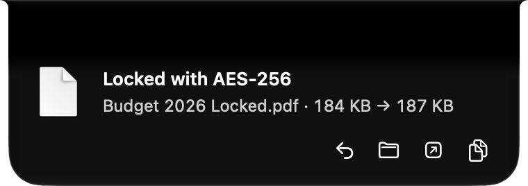

<div align="center">


&nbsp;&nbsp;&nbsp;&nbsp;


# Zivlet

**Convert, read and protect files without leaving Finder.**

Drag your files, tap a key, then drop them on a slice.

[](LICENSE)


</div>

---

Zivlet is a free, open-source file utility for macOS. Start dragging files in Finder, tap a modifier key, and a
Liquid Glass wheel opens at the pointer. Drop the files on a slice to convert them, pull the text out of a scan, read
a QR code or lock a PDF with a password. Results are saved next to the originals and progress shows at the notch. You
never open an app window.

Everything runs on your Mac. There is no account, no telemetry and no cloud service.

> [!NOTE]
> **Pre-alpha.** Zivlet has not been released, and there is no signed or notarized build yet. You can
> [build it from source](#build-from-source) today.

## Contents

- [How it works](#how-it-works)
- [Features](#features)
- [Supported formats](#supported-formats)
- [Privacy and safety](#privacy-and-safety)
- [Status](#status)
- [Roadmap](#roadmap)
- [Build from source](#build-from-source)
- [Clean room](#clean-room)
- [Contributing and security](#contributing-and-security)
- [Licence](#licence)

## How it works



Each key opens a different wheel. You can change the keys in Settings.

| Key | Wheel | What it offers |
|---|---|---|
| ⇧ Shift | **Convert** | Only the formats the files you hold can become |
| ⌘ Command | **Tools** | Copy Text, Read QR, Lock · Unlock and more |
| ⌃ Control | **Actions** | AirDrop, Drop Box, Copy to, Move to, Copy Path, Open in Terminal |

## Features

### Convert in one gesture

Drop one file or a hundred. Images are converted with Apple's ImageIO and Quartz. Audio and video go through a
bundled FFmpeg build, so there is nothing else to install.

- **Results beside the originals:** each file gets its own result with a clear name in the same folder. If that
  folder is read-only, Zivlet saves to a folder you choose instead.
- **Cancel and Undo:** stop a job while it runs, or undo it afterwards to remove what it wrote.
- **Camera raw and vector input:** DNG photos and SVG drawings convert to every image format.

### Results at the notch

<p align="center">
  
</p>

Progress appears in the notch, with Cancel always in reach. When the job ends, a card shows what was saved and how the
size changed, with one-click **Undo**, **Show in Finder**, **Open** and **Copy**. On a Mac without a notch, the same
card appears at the top of the screen. If you prefer, cards can appear where you dropped the files instead.

### Drop Box

<p align="center">
  
</p>

A shelf at the top of the screen for files you're gathering. Drag files toward the notch, or drop them on **BOX** in
the actions wheel, and they wait there until you need them. You can switch between a grid and a list, select some or
all of them, and share, AirDrop, copy, move or trash them in one go. You can also drag them back out to wherever they
belong.

### Copy Text

<p align="center">
  
</p>

Copy Text pulls the words out of photos, screenshots, scans and PDFs, and puts them on the clipboard. It uses Apple's
on-device text recognition, so nothing is uploaded. It reads **English and Hindi**, even when both are mixed in one
sentence.

- Hold **⌥** while you drop to also save a `.txt` file next to each input.
- **Show All** opens the full text when it is longer than the card.
- Copy Text never logs or stores the text it reads.

### Read QR and barcodes

<p align="center">
  
</p>

Read QR finds QR codes and barcodes in images and in every page of a PDF. Web links open with one click, and
everything else can be copied. **Copy All** collects every code from every file you dropped.

### Lock and unlock PDFs

<p align="center">
  
  &nbsp;&nbsp;
  
</p>

- **Lock** encrypts a PDF with **AES-256**. **Suggest** offers a strong password you can copy, and a meter shows the
  strength of the one you type.
- **Permissions** choose whether printing is off, at low quality or at full quality, and whether copying and editing
  are allowed.
- **Unlock** removes a password you know, from one file or a whole batch. **Change** replaces it.
- The original is never touched: the locked or unlocked copy is saved next to it.
- Zivlet never logs or stores a password.
- Copy Text and Read QR also work on locked PDFs: they ask for the password first.

### Actions

The actions wheel handles the small chores that usually take a trip through menus:

- **AirDrop** the files to a nearby device.
- **Copy to** or **Move to** a folder, with progress and Cancel. A move can be undone.
- **Copy Path** puts the files' full paths on the clipboard.
- **Open in Terminal** opens a Terminal window at the files' folder.
- **BOX** puts the files in the Drop Box.

### Made for the Mac

- The wheels and the notch use Liquid Glass, or you can pick a solid style. Zivlet follows Reduce Motion and
  Increase Contrast.
- A soft tick sounds and the trackpad gives a light tap as each slice lights up. You can turn both off.
- Zivlet starts at login if you want it to, and lives in the menu bar.

## Supported formats

| Family | Converts between | Also |
|---|---|---|
| **Images** | JPG, PNG, WebP, HEIC, TIFF, AVIF, BMP | Any image to PDF. DNG (camera raw) and SVG as inputs |
| **Audio** | MP3, M4A, WAV, FLAC, Ogg, Opus, AIFF, WMA | |
| **Video** | MP4, MOV, MKV, WebM, AVI, WMV | Video to animated GIF and GIF to video. Extract the audio as MP3 |

Documents, spreadsheets, subtitles and archives are in the format catalogue, and their conversions are on the
[roadmap](#roadmap).

## Privacy and safety

- **Offline by design.** The only network request is the check for updates, and you can turn it off in Settings.
- **No account, no telemetry, no analytics.**
- **Minimal permissions.** Zivlet only asks for access to the folders you choose.
- **Isolated parsing.** PDFs and scans are opened in a separate worker process. A damaged or hostile file can crash
  the worker but not Zivlet, and the job is retried once.
- **Checked dependencies.** Every bundled library is built from source pinned by SHA-256. A licence gate checks each
  one, and its licence ships with the app (see [THIRD_PARTY_NOTICES.md](THIRD_PARTY_NOTICES.md)).

## Status

| Milestone | What it delivers | State |
|---|---|---|
| M1 | Repository, format catalogue, output naming, trigger and wheel models | done |
| M2 | The drag-and-tap trigger and the radial wheel | done |
| M3 | First image, audio and video conversions, with Cancel, Undo and Reveal | code complete |
| M4 | Full Phase 1 conversion matrix, bundled engines, actions, Settings, onboarding and updates | code complete; notarized build pending |
| M5 | Progress and results at the notch, and the Drop Box | code complete |
| M6 | The worker process and Copy Text | code complete |
| M7 | Tool window, Read QR, password sheet, and PDF lock, unlock and password change | code complete |
| M8 | Archives, Office document passwords and more PDF tools | planned |

"Code complete" means every task is built and the automated checks pass: more than 2,500 tests and a line-coverage
gate. Hands-on QA by a person, such as real drags, the keyboard and VoiceOver, is still to come.

## Roadmap

| Phase | Release | Focus |
|---|---|---|
| 1 | 0.1 private alpha | Image, audio and video conversions, bundled engines and a notarized DMG |
| 2 | 0.5–0.7 public betas | Copy Text, lock and unlock, PDF tools, more image tools, multi-file features, the Drop Box, custom wheels, history and archives |
| 3 | 1.0 | Signatures, legacy Office unlock, custom-wheel colours and import/export, the full CLI and local transcription |
| 4 | 1.x | Meeting notes with speaker labels, requests in plain words, smart crop and more |

Every feature runs on your Mac. For the details, see:

- [docs/design/17-feature-roadmap.md](docs/design/17-feature-roadmap.md): phases, effort, licences and size;
- [docs/plan/05-task-list.md](docs/plan/05-task-list.md): milestones and task rows.

## Build from source

You need an Apple-silicon Mac with macOS 26 or later, Xcode 27 at `/Applications/Xcode.app`, XcodeGen, and the
tools that build the bundled libraries:

```sh
brew install xcodegen cmake meson ninja autoconf automake libtool pkgconf rust
```

`Vendor/check-tools.sh` names anything missing. Export `DEVELOPER_DIR` before you run `swift`, `xcodebuild` or
`make`:

```sh
export DEVELOPER_DIR=/Applications/Xcode.app/Contents/Developer
make vendor   # build FFmpeg, libwebp, the SVG renderer and qpdf from pinned sources
make app      # build an ad-hoc-signed Debug app under build/DerivedData
```

| Step | Command |
|---|---|
| Unit tests | `make test` (runs `swift test` in `Packages/ZivletKit`) |
| Coverage gate | `make coverage` (fails if any gated module drops below 80 % line coverage) |
| Lint | `make lint` (`swift format lint --strict` plus a log-privacy check). `make format` fixes formatting |
| App | `make app` (XcodeGen generates `Zivlet.xcodeproj` from `project.yml`, then xcodebuild builds the Debug app) |
| Bundled libraries | `make vendor` builds every bundled engine: FFmpeg 9.0.2 and its codecs, libwebp, the resvg-based SVG renderer, and qpdf. It rebuilds only what is missing or stale. `make vendor-test` runs the vendor script tests |
| Release check | `make release-check` fails if a Release build refers to a Homebrew path or misses a bundled helper or library |

Sources are downloaded into `Vendor/downloads` and checked against the SHA-256 in `Vendor/versions.lock`. Every app
build copies the bundled `ffmpeg` and `ffprobe` into `Contents/Helpers` and their libraries into
`Contents/Frameworks`. A Debug build looks for ffmpeg in this order:

1. the app's bundled helpers;
2. the directory named by `ZIVLET_FFMPEG_DIR`;
3. a Homebrew install (`brew install ffmpeg`).

Release builds trust only the bundled helpers. Image conversions don't need any external tool.

## Clean room

Independent, clean-room project inspired by the public behaviour of Tangerine for Mac; not affiliated with or endorsed by its developer.

Zivlet contains no code, assets, sounds, icons, UI strings or screenshots from that app (called "the reference app"
elsewhere in this repository). The behaviour is written up in `docs/`, in the project's own words.
[CONTRIBUTING.md](CONTRIBUTING.md) sets out the rule contributors follow. Every screenshot in this README is of
Zivlet itself, with sample files.

## Contributing and security

- Contributions are accepted under the Developer Certificate of Origin. See [CONTRIBUTING.md](CONTRIBUTING.md).
- Report vulnerabilities privately. See [SECURITY.md](SECURITY.md).
- Third-party components and their licences are listed in [THIRD_PARTY_NOTICES.md](THIRD_PARTY_NOTICES.md).

## Licence

Zivlet is free software. You can redistribute it and/or modify it under the terms of the GNU General Public License
as published by the Free Software Foundation, either version 3 of the License or (at your option) any later version.
See [LICENSE](LICENSE).
