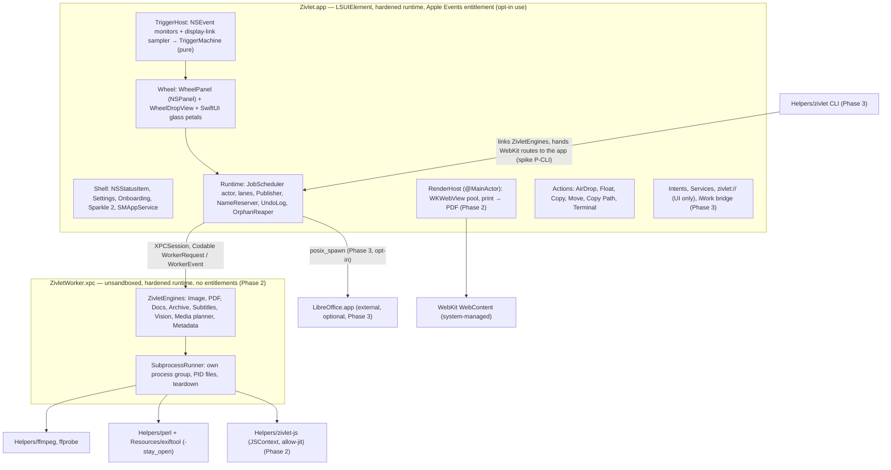
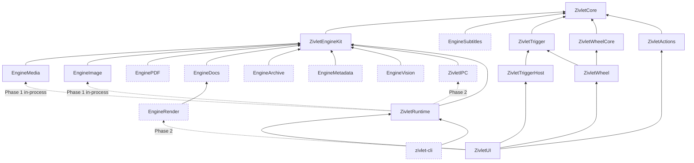
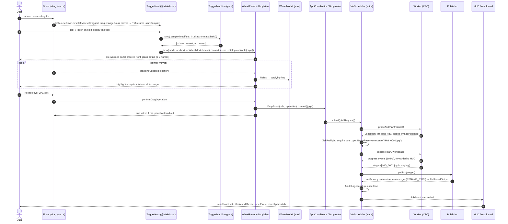

# 02 — Zivlet Architecture

Date: 2026-10-20. Status: **plan of record** for Phases 0–3. Derived from [10-tech-strategy](../design/10-tech-strategy.md) §2, §7, §8 (the `[challenge]` notes win), [14-app-platform](../design/14-app-platform.md) §1, §2, §5, [15-strategy-challenge](../design/15-strategy-challenge.md) and [00-decisions](../design/00-decisions.md). Behaviour targets come from [01-prd](01-prd.md), which describes observable behaviour only. No code, assets or text from the reference app or from Open-Tangerine are reused.

Toolchain: Swift 6.4 (Swift 6 language mode), Xcode 27 (`DEVELOPER_DIR=/Applications/Xcode.app/Contents/Developer`), XcodeGen 2.45, macOS 26.0 deployment target, arm64 only.

Adaptations to 10 §7 in this document:

| 10 §7 said | This plan | Why |
|---|---|---|
| Hand-maintained `Zivlet.xcodeproj` with synchronized folders | **XcodeGen `project.yml`**. The generated project is git-ignored. | Owner rule. Readable diffs, no pbxproj conflicts. |
| `ZivletTrigger` = pure machine + AppKit sampler in one module | Split into **`ZivletTrigger`** (pure) and **`ZivletTriggerHost`** (AppKit) | The pure module builds and tests with `swift test` and has no AppKit in its import graph. |
| `ZivletWheel` holds model + views | Split into **`ZivletWheelCore`** (pure geometry, slots, hit-test) and **`ZivletWheel`** (panel, drop view, glass views) | Same reason. Geometry and hit-testing are the risky logic. |
| `ZivletEngines` dynamic framework from day one | **Static linking in Phases 0–1.** The `ZivletEngines` dynamic product arrives in Phase 2 with the worker (ADR-10). | Phase 1 has one consumer, the app. Avoids SwiftPM duplicate-symbol traps before they matter. |
| Worker by 1.0 | Worker in **Phase 2**. Phase 1 runs in-process engines behind the same `WorkerClient` (ADR-04). | ffmpeg is out of process from day one. The in-process risk in Phase 1 is ImageIO and libwebp only. |
| IPC types inside Runtime | New **`ZivletIPC`** module (Phase 2) | The worker must not link the Runtime. |
| Actions inside `ZivletUI` | New **`ZivletActions`** module (Phase 1) | They have a separate concern (file side effects, no engines) and need their own tests. |

---

## 1. Architectural principles

| # | Principle | Enforced by |
|---|---|---|
| P1 | **Functional core, imperative shell.** Catalog, naming, planning, trigger and wheel logic are pure value code. AppKit, XPC, processes and the file system sit at the edges. | Module graph (§4), coverage gate on pure modules |
| P2 | **Immutable values cross every boundary.** Requests, plans, progress, results and wheel state are `Sendable` structs or enums. "Mutation" returns a new value. | Swift 6 strict concurrency, code review |
| P3 | **Untrusted bytes never reach a third-party parser in the app process.** Only Apple decoders run in-app, and only for previews in editor windows the user opened (10 §2.1 rule 1, as corrected). | Module rules R3/R4, worker boundary |
| P4 | **The Catalog is the single source of truth** for what the wheel, CLI, Intents, Services, website table and tests offer. | `CatalogTests` matrix, generated docs |
| P5 | **Nothing partial is ever visible.** Outputs are staged, verified, then published with one exclusive rename. The source is never modified (except by the explicit Move action). | `Publisher`, Runtime tests |
| P6 | **Permission-free by default.** No Accessibility, Input Monitoring or Screen Recording in the default flow. | Trigger design (ADR-09), onboarding QA |
| P7 | **Fail loudly, with copy.** Every failure maps to one `JobError` case with user copy and log context. Nothing is swallowed. | Error taxonomy (§9) |

---

## 2. Process model



Phase 1 runs the `ENG` box **inside the app** through `InProcessWorkerClient`. Helpers are still separate processes.

### 2.1 Processes

| Process | Isolation and signing | Entitlements | Owns | Must not | Phase |
|---|---|---|---|---|---|
| `Zivlet.app` | Developer ID, hardened runtime, unsandboxed | `automation.apple-events` (only used when the opt-in iWork bridge or Finder-selection hotkey is on) | UI, trigger, wheel, scheduler, publication, actions, RenderHost, Sparkle, network (Sparkle and the LibreOffice download only) | Run third-party parsers (libwebp, resvg, qpdf, libarchive, SDoc readers, JS) once the worker exists | 0 |
| `ZivletWorker.xpc` | Same team, hardened runtime, unsandboxed, launched on demand by launchd, exits when idle | **none** | Probe, plan and execute for every non-WebKit engine. Supervises helper children. | Touch UI, network or the user's destination folders (it writes only to staging) | 2 |
| `ffmpeg`, `ffprobe` | Signed Mach-O in `Contents/Helpers` | none | Media decode and encode, `-progress pipe:1` | Network (built with `--disable-network`), non-whitelisted demuxers or protocols | 1 |
| `perl` + ExifTool | Signed `perl` in `Helpers`; `.pm` tree and XS bundles in `Resources/perl5` | none | Metadata read, plan and write, in one `-stay_open` session | Load anything outside `PERL5LIB` | 2 |
| `zivlet-js` | Signed helper | `cs.allow-jit` (only process with it) | SheetJS, mammoth, cupertino-files over JSON-over-stdio | Network; it lives at most 60 s idle | 2 |
| `zivlet` CLI | Signed helper, links `ZivletEngines` | none | Headless conversions. Hands WebKit routes to the app. | Show UI | 3 |
| LibreOffice | TDF-signed, external, optional | — | PPT and the "Best fidelity" document routes | Run macros or fetch links (private profile) | 3 |

### 2.2 IPC contracts

| Edge | Transport | Payload | Cancellation | Failure handling |
|---|---|---|---|---|
| App → Worker | `XPCSession` (Swift XPC, macOS 14+), one session per app | `WorkerRequest` / `WorkerEvent` (Codable, §7.5); file paths, never file bytes | `WorkerRequest.cancel(JobID)` and session teardown | Session invalidation fails in-flight jobs with `.workerCrashed`. The scheduler retries each job **once, serially**. A second crash → `.engineCrashedOnInput`. |
| Worker → helpers | `posix_spawn` via swift-subprocess, pipes | argv / JSON lines | SIGINT, then SIGKILL at +1 s to the process group; LibreOffice SIGTERM, SIGKILL at +5 s | Exit status + 64 KB stderr tail → `.processFailed` |
| CLI → App | Unix socket in `~/Library/Application Support/Zivlet/`, peer signature checked from the audit token (spike P-CLI may pick an `SMAppService.agent` instead) | `JobRequest` JSON | Socket close | CLI prints the error and exits non-zero |
| App ↔ WebContent | WebKit-managed | — | `stopLoading()`; the web view is discarded | `webContentProcessDidTerminate` → `.renderFailed` |

---

## 3. Repository and build layout

```
Zivlet/                             # repo root
  project.yml                       # XcodeGen spec → Zivlet.xcodeproj (git-ignored)
  App/                              # composition root: AppDelegate, StatusItem, SparkleUpdater, Info.plist, Assets
  Worker/                           # ZivletWorker.xpc main + listener (Phase 2)
  JSHelper/                         # zivlet-js main (Phase 2)
  Extensions/FinderSync/            # 1.x
  Config/                           # Base/Debug/Release.xcconfig, *.entitlements, ExportOptions.plist
  Packages/ZivletKit/              # local SwiftPM package: ALL module code (§4, §5)
    Package.swift
    Sources/<Module>/…
    Tests/<Module>Tests/…
    Artifacts/                      # git-ignored xcframeworks fetched or built by Vendor scripts (binaryTarget paths must be inside the package)
  Vendor/                           # versions.lock, build-media.sh, build-native.sh, build-rust.sh, js/, patches/, licences/
  Fixtures/                         # generate.sh + small committed fixtures; LFS corpus
  Scripts/                          # check-imports.sh, sign-helpers.sh, verify-signatures.sh, make-dmg.sh, size-gate.sh, appcast.sh
  docs/
  .github/workflows/                # vendor.yml, ci.yml, nightly.yml, release.yml
```

### 3.1 Xcode targets (generated by XcodeGen)

| Target | Type | Sources | Package products linked | Embedded at | Phase |
|---|---|---|---|---|---|
| `Zivlet` | application | `App/` | `ZivletApp` (static); `ZivletEngines` (dynamic) from Phase 2; Sparkle (remote SPM, app only) | `Zivlet.app` | 0 |
| `ZivletWorker` | xpc-service | `Worker/` | `ZivletWorkerKit` (static: IPC) + `ZivletEngines` (dynamic) | `Contents/XPCServices/` | 2 |
| `zivlet-js` | command-line tool | `JSHelper/` | none (JavaScriptCore only) | `Contents/Helpers/` | 2 |
| `zivlet` | command-line tool | package product `zivlet` | `ZivletEngines` | `Contents/Helpers/` | 3 |
| `ZivletFinderSync` | app-extension | `Extensions/FinderSync/` | `ZivletCore` subset | `Contents/PlugIns/` | 1.x |
| `ZivletUITests` | ui-testing | `UITests/` | — | — | 1 |

Prebuilt helpers (`ffmpeg`, `ffprobe`, `perl`, the libav\* dylibs) are copied by a `postBuildScripts` phase from `Packages/ZivletKit/Artifacts/` into `Contents/Helpers` and `Contents/Frameworks`, then signed inside-out by `Scripts/sign-helpers.sh` in release builds.

Build settings shared by all Swift targets (`Config/Base.xcconfig`): `SWIFT_VERSION = 6`, `SWIFT_STRICT_CONCURRENCY = complete`, `SWIFT_APPROACHABLE_CONCURRENCY = YES`, `MACOSX_DEPLOYMENT_TARGET = 26.0`, `ARCHS = arm64`, `ENABLE_HARDENED_RUNTIME = YES`. The `Zivlet` app target also sets `SWIFT_DEFAULT_ACTOR_ISOLATION = MainActor`.

---

## 4. Module graph (ZivletKit)



Arrows point from a module to what it imports. Dashed boxes arrive after Phase 1.

### 4.1 Modules

| Module | Layer | Depends on | Contents | Pure? `swift test` | AppKit | Phase |
|---|---|---|---|---|---|---|
| `ZivletCore` | domain | Foundation, UniformTypeIdentifiers | `Format`, `Catalog`, `Route`, `ToolSpec`, `ActionID`, `JobRequest` + options, `OutputNamer`, `JobError`, `JobProgress` | **Pure.** Yes | No | 0 |
| `ZivletEngineKit` | engine SPI | Core, swift-subprocess, Security, Synchronization | `Engine`, `ExecutionPlan`, `Stage`, `Lane`, `JobWorkspace`, `ProgressSink`, `OutputVerifier`, `SubprocessRunner`, `EngineLocator`, `CapabilityProbe`, `EngineRegistry` | Plan types pure. Runner tested with `sleep`/`yes`. Yes | No | 0 |
| `EngineMedia` | engine | EngineKit | ffprobe → `MediaInfo`, **pure argv planners**, progress parser, verifier | Planners pure (golden). Execution tests need ffmpeg from `Artifacts/` (tag `.integration`). Yes | No | 1 |
| `EngineImage` | engine | EngineKit, `CWebP` (P1), `ZivletRS` (P2) | ImageIO / Core Image pipelines, Quartz image → PDF, WebP, later SVG, PNG optimise, compress search | Plans pure. Pipelines run headless. Yes | No | 1 |
| `EnginePDF` | engine | EngineKit, `CQPDF` | PDFKit operations, Quartz filters, qpdf job JSON, raster, redaction v1 | Yes (PDFKit links AppKit transitively but no UI is used) | No import | 2 |
| `EngineDocs` | engine | EngineKit, ZIPFoundation, SwiftSoup, swift-markdown | SDoc model, readers, writers, `JSClient`, `OfficeEngine`, PDF + Vision fusion | Readers and writers pure. Yes | No | 2 |
| `EngineArchive` | engine | EngineKit, `CArchive` | Hardened extract, re-pack, create | Yes | No | 2 |
| `EngineSubtitles` | engine | Core | SRT/VTT parse and write | **Pure.** Yes (+ fuzz) | No | 2 |
| `EngineMetadata` | engine | EngineKit | `ExifToolSession` actor, ffmpeg and qpdf strip paths, verify contract | Planner pure. Session needs perl (`.integration`). | No | 2 |
| `EngineVision` | engine | EngineKit | Barcodes (Read QR), OCR, masks, faces, warm-up | Yes (slow tests tagged) | No | 2 |
| `EngineRender` | app-only engine | EngineDocs, WebKit | `RenderHost`: WKWebView pool, scheme handler, content rules, print, snapshot | No (needs a window-server session; Xcode test plan) | Yes | 2 |
| `ZivletIPC` | boundary | EngineKit | `WorkerRequest`, `WorkerEvent`, versioned envelope | **Pure.** Yes (round-trip tests) | No | 2 |
| `ZivletRuntime` | application | EngineKit, (P1) EngineMedia + EngineImage, (P2) IPC | `JobScheduler`, `AsyncSemaphore`, `WorkerClient` (+ in-process and XPC), `Publisher`, `NameReserver`, `UndoLog`, `OrphanReaper`, `BatchAggregator`, `DiskPreflight` | Logic yes. File-system tests use temp dirs. | No | 1 |
| `ZivletTrigger` | domain | Core | `TriggerMachine`, `InputSample`, `TriggerEvent`, `TriggerEffect`, `ModifierMask`, trace codec | **Pure.** Yes (recorded traces) | No | 0 |
| `ZivletTriggerHost` | shell | Trigger, AppKit | `DragSampler` (NSEvent monitors, `NSScreen.displayLink`), drag-pasteboard probe, Esc hotkey (spike P-T3) | Pure helpers only | Yes | 0 |
| `ZivletWheelCore` | domain | Core | `WheelModel`, `WheelGeometry`, `WheelSlot`, `HitResult`, slot builders from Catalog | **Pure.** Yes | No | 0 |
| `ZivletWheel` | shell | WheelCore, Trigger, AppKit, SwiftUI | `WheelPanel`, `WheelDropView`, `WheelStore` (@Observable), `PetalShape`, `WheelView`, haptics, sound | Geometry via WheelCore; Solid-theme snapshots in Xcode | Yes | 0 |
| `ZivletActions` | shell | Core, AppKit | AirDrop (`NSSharingService`), Float shelf, Copy, Move, Copy Path, Terminal | Path formatting and quoting pure | Yes | 1 |
| `ZivletUI` | shell | Wheel, TriggerHost, Runtime, Actions, (P2) EngineRender, KeyboardShortcuts | `AppCoordinator`, `DropIntake`, HUD and result card, Settings, onboarding, tool editors | View models only | Yes | 1 |
| `zivlet-cli` | front end | Runtime, ArgumentParser | `convert`, `tool`, `formats`, `info`, `wheel` | Command parsing yes | No | 3 |

### 4.2 Dependency rules

| # | Rule | Enforcement |
|---|---|---|
| R1 | `ZivletCore`, `ZivletTrigger`, `ZivletWheelCore`, `ZivletIPC`, `EngineSubtitles` import only Foundation, UniformTypeIdentifiers, Synchronization and `os` (logging) [critic3]. | `Scripts/check-imports.sh` in CI (grep of `import` lines against an allowlist per module) |
| R2 | No module outside the shell layer (`ZivletTriggerHost`, `ZivletWheel`, `ZivletActions`, `ZivletUI`, `EngineRender`, app target) imports AppKit, SwiftUI or WebKit. | check-imports |
| R3 | Trigger, Wheel and Actions modules never import an engine module. They see formats only through `ZivletCore`. | SwiftPM graph (no declared dependency) |
| R4 | Engines never import Runtime, IPC or any shell module. Engines never write outside their `JobWorkspace`. | SwiftPM graph; `JobWorkspace` API exposes only staging and scratch URLs |
| R5 | Only `ZivletRuntime` talks to a `WorkerClient`. UI submits `JobRequest`s and observes `JobEvent`s. | Access control (`package` visibility for clients) |
| R6 | All types crossing module boundaries in the job path are `Sendable` and `Codable`. | Compiler (Swift 6) + IPC round-trip tests |
| R7 | No global mutable state. Shared caches use `Mutex` or an actor. | Strict concurrency + review |
| R8 | `@unchecked Sendable` only in C-wrapper files listed in `Sources/*/Unsafe/` (one handle per task, documented). | check-imports flags any other use |
| R9 | Sparkle is linked by the app target only. KeyboardShortcuts only by `ZivletUI`. | project.yml / Package.swift |

---

## 5. Package.swift

### 5.1 Phase 0–1 (exact)

```swift
// swift-tools-version: 6.2
import PackageDescription

let core: [SwiftSetting] = [
    .enableUpcomingFeature("NonisolatedNonsendingByDefault"),   // SE-0461
    .enableUpcomingFeature("InferIsolatedConformances"),        // SE-0470
    .enableUpcomingFeature("ExistentialAny"),                   // SE-0335
    .enableUpcomingFeature("MemberImportVisibility"),           // SE-0444
]
let ui: [SwiftSetting] = core + [.defaultIsolation(MainActor.self)]  // SE-0466

let package = Package(
    name: "ZivletKit",
    platforms: [.macOS(.v26)],
    products: [
        .library(name: "ZivletApp", targets: ["ZivletUI"]),   // pulls the whole app graph statically
    ],
    dependencies: [
        .package(url: "https://github.com/swiftlang/swift-subprocess", from: "1.0.2"),
        .package(url: "https://github.com/sindresorhus/KeyboardShortcuts", from: "3.1.0"),
    ],
    targets: [
        .target(name: "ZivletCore", swiftSettings: core),
        .target(name: "ZivletEngineKit",
                dependencies: ["ZivletCore", .product(name: "Subprocess", package: "swift-subprocess")],
                swiftSettings: core),
        .binaryTarget(name: "CWebP", path: "Artifacts/CWebP.xcframework"),
        .target(name: "EngineMedia", dependencies: ["ZivletEngineKit"], swiftSettings: core),
        .target(name: "EngineImage", dependencies: ["ZivletEngineKit", "CWebP"], swiftSettings: core),
        .target(name: "ZivletRuntime",
                dependencies: ["ZivletEngineKit", "EngineMedia", "EngineImage"], swiftSettings: core),
        .target(name: "ZivletTrigger", dependencies: ["ZivletCore"], swiftSettings: core),
        .target(name: "ZivletTriggerHost", dependencies: ["ZivletTrigger"], swiftSettings: ui),
        .target(name: "ZivletWheelCore", dependencies: ["ZivletCore"], swiftSettings: core),
        .target(name: "ZivletWheel", dependencies: ["ZivletWheelCore", "ZivletTrigger"],
                resources: [.process("Resources")], swiftSettings: ui),
        .target(name: "ZivletActions", dependencies: ["ZivletCore"], swiftSettings: ui),
        .target(name: "ZivletUI",
                dependencies: ["ZivletWheel", "ZivletTriggerHost", "ZivletRuntime", "ZivletActions",
                               "KeyboardShortcuts"],
                swiftSettings: ui),

        .testTarget(name: "ZivletCoreTests", dependencies: ["ZivletCore"], swiftSettings: core),
        .testTarget(name: "ZivletEngineKitTests", dependencies: ["ZivletEngineKit"], swiftSettings: core),
        .testTarget(name: "EngineMediaTests", dependencies: ["EngineMedia"],
                    resources: [.copy("Goldens")], swiftSettings: core),
        .testTarget(name: "EngineImageTests", dependencies: ["EngineImage"],
                    resources: [.copy("Fixtures")], swiftSettings: core),
        .testTarget(name: "ZivletRuntimeTests", dependencies: ["ZivletRuntime"], swiftSettings: core),
        .testTarget(name: "ZivletTriggerTests", dependencies: ["ZivletTrigger"],
                    resources: [.copy("Traces")], swiftSettings: core),
        .testTarget(name: "ZivletWheelCoreTests", dependencies: ["ZivletWheelCore"], swiftSettings: core),
        .testTarget(name: "ZivletActionsTests", dependencies: ["ZivletActions"], swiftSettings: ui),
    ]
)
```

Phase 0 ships the same file without `CWebP`, `EngineMedia`, `EngineImage` and `ZivletActions` (the skeleton has Core, EngineKit, Runtime stub, Trigger, TriggerHost, WheelCore, Wheel, UI shell). `swift test` runs from `Packages/ZivletKit` with the Xcode 27 toolchain. Tests tagged `.integration` need `Artifacts/` and are skipped when it is missing.

### 5.2 Later additions

| Phase | Products added | Targets added | Dependencies added |
|---|---|---|---|
| 2 | `.library(name: "ZivletEngines", type: .dynamic, targets: [Core, EngineKit, all non-render engines])`; `.library(name: "ZivletWorkerKit", targets: ["ZivletIPC"])`. `ZivletApp` then depends on engines **only through** `ZivletEngines` (spike P-PKG, ADR-10). | `EnginePDF`, `EngineDocs`, `EngineRender`, `EngineArchive`, `EngineSubtitles`, `EngineMetadata`, `EngineVision`, `ZivletIPC`; binary `CArchive`, `CQPDF`, `ZivletRS`; tests for each | ZIPFoundation 0.9.20, SwiftSoup 2.14.3, swift-markdown 0.9.0 |
| 3 | `.executable(name: "zivlet", targets: ["zivlet-cli"])` | `zivlet-cli`, `ZivletCLITests` | swift-argument-parser 1.7.2 |
| 1.x | — | `ZivletPresets` (pinned presets, custom wheels), `ZivletFinderSyncKit` | — |

`ZivletRuntime` drops its direct `EngineMedia`/`EngineImage` dependency in Phase 2; it resolves engines through `EngineRegistry` (in-process fallback) or the worker.

---

## 6. Concurrency and isolation model

### 6.1 Settings

| Setting | Non-UI modules | UI modules (`TriggerHost`, `Wheel`, `Actions`, `UI`, `EngineRender`, app target) |
|---|---|---|
| Language mode | Swift 6 | Swift 6 |
| Default isolation | nonisolated | `MainActor` (SE-0466) |
| `NonisolatedNonsendingByDefault` | on: plain `async` functions run on the caller's executor | on |
| Heavy work | `@concurrent` functions only | never on the main actor; hop via Runtime |
| Shared mutable state | `actor` (async access) or `Mutex` (sync, tiny critical sections) | `@Observable @MainActor` stores holding immutable values |

### 6.2 Per module

| Module | Isolation | Notes |
|---|---|---|
| `ZivletCore` | nonisolated, all values `Sendable` | `Catalog.standard` is a `static let` built once. No async code. |
| `ZivletEngineKit` | nonisolated | `Engine.plan` is synchronous and pure. `Engine.execute` is `@concurrent`. `ProgressSink` is a `Sendable` struct over `AsyncStream.Continuation` with a `Mutex`-guarded 10 Hz throttle. `CapabilityProbe` cache is an actor. |
| Engines | nonisolated `Sendable` structs | C handles (libwebp, libarchive, qpdf) live inside one `execute` call. Cooperative `Task.checkCancellation()` between frames, pages and entries. |
| `EngineMetadata` | `actor ExifToolSession` | Serialises the single `-stay_open` pipe. A second session is spawned when the queue exceeds 20. |
| `EngineRender` | `@MainActor` | WKWebView requires it. Print is serialised (lane `render` width 1 until D-PRINT2). |
| `ZivletIPC` | nonisolated values | Envelope carries `protocolVersion`. |
| `ZivletRuntime` | `actor JobScheduler`, `actor NameReserver`, `actor UndoLog`, `actor AsyncSemaphore` per lane | `Publisher` and `DiskPreflight` are nonisolated with `@concurrent` file operations. Events go out through `AsyncStream<JobEvent>`. |
| `ZivletTrigger` | nonisolated pure struct | No clocks: time arrives inside `InputSample.uptime`. |
| `ZivletTriggerHost` | `@MainActor` | Monitors and display-link callbacks run on main. Work per tick ≤ 50 µs. |
| `ZivletWheelCore` | nonisolated pure | Hit-test is O(1) per `draggingUpdated`. |
| `ZivletWheel`, `ZivletUI`, `ZivletActions` | `@MainActor` | `WheelStore` holds a `WheelModel` value and replaces it. `performDragOperation` returns in ≤ 1 ms. |
| Worker (`Worker/`) | listener handler nonisolated; `actor WorkerJobTable` maps `JobID → Task` | Each request runs in its own `Task`. Cancel looks up and cancels the task. |

### 6.3 Rules

1. Only immutable `Sendable` values cross isolation domains. No closures that capture mutable state cross into `@concurrent` work.
2. Cancellation is structural. UI cancel → `Task.cancel()` on the job task → scheduler marks `.cancelled` (≤ 100 ms visible) → `WorkerClient.cancel` → worker task cancelled → swift-subprocess teardown on the process group (≤ 1 s).
3. Every lane uses a bounded `TaskGroup` and our own cancellation-aware `AsyncSemaphore`. Memory pressure `.warning` halves widths; `.critical` pauses admission.
4. QoS: drops from the wheel use `.userInitiated`; batches above 10 items and CLI jobs use `.utility` (child processes inherit it via `posix_spawnattr_set_qos_class_np`).

---

## 7. Key contracts

Signatures are normative. Bodies and private members are omitted.

### 7.1 Formats and Catalog (`ZivletCore`)

```swift
public enum FormatID: String, Codable, Sendable, CaseIterable {
    case jpg, png, webp, heic, tiff, avif, bmp, svg, pdf          // raster + vector + PDF
    case mp3, m4a, wav, flac, ogg, opus, aiff, wma                 // audio
    case mp4, mov, mkv, webm, avi, wmv, gif                        // video (GIF mixes as video)
    case srt, vtt                                                  // subtitles
    case docx, pages, md, rtf, rtfd, textClipping, txt, html, epub // documents
    case pptx, ppt, xlsx, xls, ods, csv, tsv                       // slides + sheets
    case zip, tar, gz, rar                                         // archives
}   // 46 cases; html is output-only

public enum FormatFamily: String, Codable, Sendable { case image, audio, video, subtitle, document, slides, spreadsheet, archive }

public struct Format: Sendable, Hashable, Codable {
    public let id: FormatID
    public let family: FormatFamily
    public let mixingFamily: FormatFamily      // PDF mixes as .document, GIF as .video
    public let wheelLabel: String              // "JPG", "GZIP"
    public let extensions: [String]            // first is canonical; "tar.gz" handled as one unit
    public let contentTypes: [String]          // UTType identifiers
    public let isInputOnly: Bool, isOutputOnly: Bool
}

public struct EngineID: RawRepresentable, Hashable, Codable, Sendable { public let rawValue: String }

public struct Route: Sendable, Hashable, Codable {
    public let source: FormatID, target: FormatID
    public let engines: [EngineID]             // ordered preference; first available wins
    public let introducedIn: Milestone         // .phase1 … .phase3, .v1x
}

public enum Operation: Sendable, Hashable, Codable {
    case convert(to: FormatID)
    case tool(ToolID)
}

public struct Catalog: Sendable {
    public static let standard: Catalog
    public func format(_ id: FormatID) -> Format
    public func format(forContentType uti: String, extension ext: String) -> FormatID?
    public func route(from: FormatID, to: FormatID) -> Route?
    public func targets(for sources: [FormatID]) -> [FormatID]          // same-family intersection, wheel order; mixed families → badged union in WheelCore (03a §2.6) [critic3]
    public func tools(for sources: [FormatID], itemCount: Int) -> [ToolID]
    public var actions: [ActionID] { get }                             // always the 6, fixed order
    public func available(given caps: CapabilitySnapshot) -> Catalog    // returns a filtered copy
    public func hiddenReasons(given caps: CapabilitySnapshot) -> [RouteKey: UnavailableReason]
}

public struct ToolSpec: Sendable, Hashable, Codable {
    public let id: ToolID
    public let wheelLabel: String, symbolName: String
    public let outputSuffix: String?           // "Compressed", "Trimmed", …
    public let presentation: Presentation      // .instant | .editor
    public let cardinality: Cardinality        // .single | .multiAllowed | .multiOnly (combining)
    public let engines: [EngineID]
}
```

### 7.2 Jobs (`ZivletCore`)

```swift
public struct JobID: Hashable, Codable, Sendable { public let raw: UUID }

public struct InputItem: Sendable, Hashable, Codable {
    public let url: URL, format: FormatID, byteCount: Int64
    public let isPromised: Bool                // file promise received into staging
    public let quarantine: Data?               // com.apple.quarantine value, propagated to outputs
}

public enum DestinationPolicy: Sendable, Hashable, Codable { case besideOriginal(fallback: URL), folder(URL) }

public enum JobOrigin: String, Sendable, Codable { case wheel, editor, cli, intent, service, urlScheme }

public struct JobRequest: Sendable, Hashable, Codable {
    public let id: JobID
    public let inputs: [InputItem]             // non-empty; validated by init
    public let operation: Operation
    public let options: OperationOptions       // typed per operation; defaults from Settings
    public let destination: DestinationPolicy
    public let origin: JobOrigin
    public init(inputs: [InputItem], operation: Operation, options: OperationOptions,
                destination: DestinationPolicy, origin: JobOrigin) throws(JobError)
    public func with(options: OperationOptions) -> JobRequest
}

public enum JobState: Sendable, Equatable {
    case queued, probing, planned, running(JobProgress), verifying, publishing
    case succeeded([PublishedOutput]), failed(JobError), cancelled
}

public struct JobProgress: Sendable, Equatable, Codable {
    public let stage: Int, stageCount: Int
    public let fraction: Double?, bytesWritten: Int64?, eta: Duration?   // fraction nil = indeterminate
}
```

### 7.3 Engines and plans (`ZivletEngineKit`)

```swift
public protocol Engine: Sendable {
    static var id: EngineID { get }
    func capabilities() async -> EngineCapabilities           // cached by binary hash + OS build
    func probe(_ input: InputItem) async throws -> InputProbe
    func plan(_ request: JobRequest, inputs: [InputProbe],
              caps: EngineCapabilities) throws -> ExecutionPlan // PURE, golden-tested
    @concurrent func execute(_ plan: ExecutionPlan, in workspace: JobWorkspace,
                             progress: ProgressSink) async throws -> [StagedOutput]
}

public enum Lane: String, Codable, Sendable, CaseIterable {
    case cpu, remux, audio, hwVideo, swVideo, render, js, vision, metadata, office, iwork
}

public enum Stage: Sendable, Codable, Equatable {
    case ffmpeg(argv: [String], expectedDuration: Duration?), qpdf(jobJSON: String)
    case imagePipeline(ImagePipelineSpec), webpEncode(WebPSpec), vision(VisionSpec), archive(ArchiveSpec)
    case exiftool(commands: [[String]]), js(script: JSScriptID, input: JSONValue)
    case render(RenderSpec)                     // app-only; the worker rejects it
}

public struct ExecutionPlan: Sendable, Codable, Equatable {
    public let engine: EngineID
    public let stages: [Stage]
    public let stageWeights: [Double]           // sums to 1
    public let lanes: [Lane]                    // one per stage
    public let expectedOutputs: [OutputSpec]
    public let verification: VerificationSpec
    public let estimatedOutputBytes: Int64      // disk preflight
}

public struct OutputSpec: Sendable, Codable, Equatable {
    public let format: FormatID
    public let proposedName: String             // from OutputNamer, before collision handling
    public let isFolder: Bool                   // "<base> Pages", "<base> Clips", …
}
public struct StagedOutput: Sendable, Codable, Equatable { public let spec: OutputSpec, stagedURL: URL, byteCount: Int64 }
public struct JobWorkspace: Sendable {          // staging: same volume as destination
    public let id: JobID, staging: URL, scratch: URL   // scratch: ~/Library/Caches/<bundle>/Jobs/<id>/
}
```

### 7.4 Runtime (`ZivletRuntime`)

```swift
package protocol WorkerClient: Sendable {
    func probeAndPlan(_ request: JobRequest) async throws(JobError) -> ExecutionPlan
    func execute(_ plan: ExecutionPlan, job: JobID, workspace: JobWorkspace,
                 progress: ProgressSink) async throws(JobError) -> [StagedOutput]
    func cancel(_ job: JobID) async
}
// Implementations: InProcessWorkerClient (Phase 1, fallback), XPCWorkerClient (Phase 2).

public actor JobScheduler {
    public init(worker: some WorkerClient, publisher: Publisher, lanes: LaneWidths)
    public func submit(_ requests: [JobRequest]) -> BatchID
    public func cancel(_ job: JobID)
    public func cancel(batch: BatchID)
    public nonisolated var events: AsyncStream<JobEvent> { get }   // state changes, 10 Hz progress
}

public struct Publisher: Sendable {
    // staging → verify → copy quarantine/tags → renamex_np(RENAME_EXCL) collision loop
    @concurrent public func publish(_ outputs: [StagedOutput], for request: JobRequest,
                                    names: NameReserver) async throws(JobError) -> [PublishedOutput]
}
```

### 7.5 Worker IPC (`ZivletIPC`, Phase 2)

```swift
public struct Envelope<Body: Codable & Sendable>: Codable, Sendable {
    public let protocolVersion: Int             // bump on any breaking change; mismatch → .engineDamaged
    public let body: Body
}
public enum WorkerRequest: Codable, Sendable {
    case probeAndPlan(JobRequest)
    case execute(JobID, ExecutionPlan, JobWorkspace.Paths)
    case cancel(JobID)
    case capabilities
}
public enum WorkerEvent: Codable, Sendable {
    case planned(JobID, ExecutionPlan)
    case progress(JobID, JobProgress)
    case staged(JobID, [StagedOutput])
    case failed(JobID, JobError)
    case capabilities(CapabilitySnapshot)
}
```

### 7.6 Trigger (`ZivletTrigger`)

```swift
public struct ModifierMask: OptionSet, Sendable, Hashable, Codable { public let rawValue: UInt8 }  // ⌃⌥⇧⌘ bits only
public enum WheelMode: String, Sendable, Codable, CaseIterable { case convert, tools, actions }

public struct InputSample: Sendable, Equatable, Codable {
    public let uptime: Duration                 // monotonic, from the host
    public let modifiers: ModifierMask, primaryButtonDown: Bool, dragChangeCount: Int
    public let drag: DragSummary?               // nil until the pasteboard count moves
    public let location: CGPoint                // global, bottom-left origin
    public let pointerInsideWheel: Bool
}
public struct DragSummary: Sendable, Equatable, Codable {
    public let hasFiles: Bool                   // file URLs or file promises
    public let formats: [FormatID]?             // nil = types-only (provisional)
    public let itemCount: Int, containsFolders: Bool
}
public enum TriggerEvent: Sendable, Equatable, Codable {
    case sample(InputSample)
    case escape                                 // Carbon hotkey while visible (spike P-T3)
    case spaceChanged, dropHandled              // dropHandled: WheelDropView accepted or refused
}
public enum TriggerEffect: Sendable, Equatable, Codable {
    case startSampler, stopSampler              // event-woken → frame-sampled → idle
    case show(WheelMode, at: Point2D), switchTo(WheelMode), hide(HideReason)   // Point2D keeps the pure module free of CoreGraphics (06 D2) [critic3]
}
public enum HideReason: String, Sendable, Codable { case sameModifierRetap, escape, buttonUp, lingerExpired, spaceChanged, dropped }

public struct TriggerConfig: Sendable, Equatable, Codable {
    public let bindings: [WheelMode: ModifierMask]   // default ⇧ convert, ⌘ tools, ⌃ actions; unique
    public let honorsModifierHeldAtDragStart: Bool   // default false: ignored until re-pressed (01-prd FR-4) [critic3]; true = parity
    public let retapClosesWheel: Bool                // default true (Zivlet addition)
    public let releaseTimeout: Duration              // default 150 ms (03a §1.5) [critic3]
    public let edgeDebounce: Duration                // default 40 ms
}

public struct TriggerMachine: Sendable, Equatable {
    public init(config: TriggerConfig)
    public var phase: Phase { get }                  // .idle, .armed, .live, .wheel(WheelMode)
    public func step(_ event: TriggerEvent) -> TriggerStep   // pure; returns the next machine
}
public struct TriggerStep: Sendable, Equatable { public let next: TriggerMachine, effects: [TriggerEffect] }
```

Semantics (tested by recorded traces): a wheel opens on the **press edge** of a modifier set that **exactly** equals one binding while a file drag is live. Release never changes the wheel. Another binding's edge switches mode in place. An unbound set (for example ⇧⌘) changes nothing. Button up hides.

### 7.7 Wheel (`ZivletWheelCore`)

[critic3] M1 implements these pure signatures with `ZivletCore.Point2D` instead of `CGPoint`/`CGRect` (06 index D2); the shell converts at the AppKit boundary. §7.6 `InputSample.location` likewise.

```swift
public struct WheelGeometry: Sendable, Equatable, Codable {
    public let hubRadius, petalInner, petalOuter, ringOuter, gap, labelRadius: Double
    public let panelSide: Double
    public static let standard: WheelGeometry       // values owned by 03-visual design doc
}
public struct WheelSlot: Sendable, Identifiable, Equatable {
    public let id: SlotID                            // stable per mode → glass morph identity
    public let label: String, symbolName: String?
    public let target: SlotTarget                    // .operation(Operation) | .action(ActionID)
    public let startAngle, endAngle: Double          // radians, slot 0 at 12 o'clock, clockwise (n = 3 starts at 9)
}
public enum WheelContent: Sendable, Equatable { case slots([WheelSlot]), empty(EmptyReason) }  // 1…12 slots; empty → pill, drop refused
public enum HitResult: Sendable, Equatable { case hub, slot(SlotID), gap(lastSlot: SlotID?), outside }

public struct WheelModel: Sendable, Equatable {
    public let mode: WheelMode
    public let anchor: CGPoint                       // never follows the pointer
    public let geometry: WheelGeometry
    public let content: WheelContent
    public let highlighted: SlotID?
    public let hubLabel: String                      // size, "3 PNG FILES", or the hot slot label

    public static func make(mode: WheelMode, items: DragSummary, catalog: Catalog,
                            anchor: CGPoint, screen: CGRect) -> WheelModel
    public func hitTest(_ point: CGPoint) -> HitResult
    public func applying(_ hit: HitResult) -> WheelModel      // new value; same value if unchanged
    public func switching(to mode: WheelMode, catalog: Catalog) -> WheelModel
    public var dropTarget: SlotTarget? { get }               // nil → refuse the drop (snap back)
}
```

`WheelStore` (`@Observable @MainActor`, in `ZivletWheel`) holds one `WheelModel` and replaces it only when `applying(_:)` returns a different value, so SwiftUI re-renders only on a slot change.

---

## 8. Data flow: one drop, end to end

Scenario: a 12 MP HEIC dragged from Finder, ⇧ tapped, dropped on JPG. Phase 2 process layout shown; in Phase 1 the worker lifeline is in-process.



| Step | Budget | Owner | Failure path |
|---|---|---|---|
| Tap → first wheel frame | p95 ≤ 16 ms at 120 Hz, ≤ 33 ms at 60 Hz | TriggerHost, Wheel | Signpost regression fails nightly |
| `performDragOperation` return | ≤ 1 ms | WheelDropView | Work is always deferred to a `Task` |
| Drop → HUD visible | ≤ 50 ms | UI | — |
| Probe + plan | ≤ 30 ms for images (ImageIO header read) | Worker | `.unsupportedInput`, `.passwordRequired` → HUD error row |
| Admit | immediate unless lane full | Scheduler | `.diskFull` before any work |
| Execute | HEIC 12 MP → JPEG ≤ 150 ms | Engine | Worker crash → one serial retry |
| Publish | one `renamex_np` | Publisher | `EEXIST` → next name; `EACCES`/read-only → Downloads fallback + notice |

Variants: **tool with editor** → UI opens the editor window at the wheel anchor; Apply creates the `JobRequest`. **Action** → `ZivletActions` runs in-app, no scheduler. **File promise** (Mail, Photos) → `NSFilePromiseReceiver` into a staging folder; destination falls back to `~/Downloads`. **Drop on hub, gap or empty wheel** → `prepareForDragOperation` returns `false`, Finder snaps back. **Modifier still held at release** → `draggingUpdated` returns the first of `.copy, .generic, .link, .move` in the source mask; Zivlet always applies copy semantics (15 §C-8).

---

## 9. Error taxonomy

One enum in `ZivletCore`. Engines throw their own errors (`MediaError`, `ImageError`, `ArchiveError`, …) that conform to `JobErrorConvertible`. The worker and Runtime convert them at the boundary, so only `JobError` crosses XPC and reaches UI.

[critic3] Earlier drafts used an error-type name that also appears in the public Open-Tangerine project; `JobError` is Zivlet's own name, so no type name is shared (00-decisions O-12 note).

```swift
public enum JobError: Error, Sendable, Equatable, Codable {
    // input
    case pairNotSupported(FormatID, FormatID), unsupportedInput(reason: InputRejection)
    case passwordRequired, drmProtected, inputChanged          // inputChanged: size/mtime moved mid-job
    case limitExceeded(LimitKind), invalidOptions(field: String)
    // environment
    case engineMissing(EngineID), engineDamaged(EngineID), optionalEngineRequired(OptionalEngine)
    case diskFull(needed: Int64), permissionDenied(location: URL)
    // execution
    case processFailed(status: Int32, stderrTail: String), crashed(signal: Int32)
    case workerCrashed, engineCrashedOnInput, timedOut(stage: Int), renderFailed, cancelled
    // outcome
    case verificationFailed(detail: String), alreadyOptimal(original: Int64, result: Int64)
    case publishFailed(errno: Int32)
    case internalInvariant(String)                             // bug; logged at .fault
}
```

| Category | Cases | User surface | Retry | Logged context (paths `.private`) |
|---|---|---|---|---|
| Input | pairNotSupported, unsupportedInput, passwordRequired, drmProtected, inputChanged, limitExceeded | HUD row, specific copy ("This file can't be converted to WebM: it has no video track.") | No (inputChanged: yes) | probe summary, limits |
| Options | invalidOptions | Inline in the editor | User fixes | field |
| Environment | engineMissing, engineDamaged, optionalEngineRequired, diskFull, permissionDenied | Card with action (Reinstall, Install engine, Open Privacy settings) | After fix | signature check result, errno |
| Execution | processFailed, crashed, workerCrashed, engineCrashedOnInput, timedOut, renderFailed | "The conversion failed." + Show details | workerCrashed: automatic once | argv, 64 KB stderr tail, signal, stage, elapsed |
| Cancellation | cancelled | "Cancelled" | Yes | stage |
| Outcome | verificationFailed, alreadyOptimal, publishFailed | alreadyOptimal is a success-style notice; others are errors | publishFailed: yes | expected vs actual, sizes |
| Bug | internalInvariant | "Something went wrong." + Copy diagnostics | Yes | full context at `.fault` |

Rules: no `try?` in the job path. Every `catch` either converts to `JobError` or rethrows. A batch reports every failure per file and continues. `JobError` carries no user copy; `ZivletUI` maps cases to localised strings from the string catalog (O-15).

---

## 10. Extension points

| Extension | How | Touches | Guard |
|---|---|---|---|
| New conversion route | Add a `Route` row to Catalog data and a planner branch in the engine | Core (data), one engine | Matrix test fails until the route passes; `introducedIn` hides it from older phases |
| New engine | Type conforming to `Engine`, registered in `EngineRegistry`; new `Stage` case if it needs a new executor | EngineKit, new engine module, IPC version | Capability probe hides routes when the engine is unavailable |
| New tool | `ToolSpec` row + planner; editor view in `ZivletUI` if `.editor` | Core, engine, UI | Output suffix test, cardinality tests |
| New action | `ActionID` case + handler in `ZivletActions` | Core, Actions | Actions wheel layout test (1–12 slots) |
| New front end | Any producer of `JobRequest` (CLI, App Intents, Services, URL scheme, Finder Sync) | Front-end target only | Front ends never call engines directly (R5) |
| Optional external engine | `CapabilityProbe` source + `OptionalEngine` case (LibreOffice, iWork) | EngineKit, EngineDocs | `optionalEngineRequired` with install card |
| Worker transport | New `WorkerClient` (e.g. sandboxed worker with fd passing, P-8, 2.x) | Runtime | Same contract tests run against every client |
| Wheel customisation (1.x) | `ZivletPresets` produces a filtered or reordered `[WheelSlot]` | WheelCore | Slots still come from Catalog; no free-form commands |
| Not an extension point | Third-party plug-ins or scripts loaded at runtime | — | Rejected: code-signing, GPL and security surface (ADR-12) |

---

## 11. Architecture decision records

### ADR-01 XcodeGen project plus one local SwiftPM package

- **Context.** 10 §7.1 chose a hand-kept `.xcodeproj`. The owner rule requires XcodeGen. Pure logic must be testable without Xcode UI tooling.
- **Decision.** `project.yml` (XcodeGen 2.45) generates `Zivlet.xcodeproj`, which is git-ignored. All module code lives in `Packages/ZivletKit`. Xcode targets contain only entry points, plists, entitlements and resources.
- **Consequences.** `swift test` covers every pure module on any Mac with Xcode 27. CI runs `xcodegen generate` before `xcodebuild`. Contributors need `brew install xcodegen`. Build settings live in xcconfigs, so they stay readable. Package resources and binary targets must sit inside the package directory (`Artifacts/`).

### ADR-02 Functional core, AppKit shell

- **Context.** The riskiest logic (trigger state, wheel geometry and hit-testing, route selection, argv planning, naming) is where apps of this kind break, and it is hard to test through UI.
- **Decision.** These live in pure modules (`ZivletCore`, `ZivletTrigger`, `ZivletWheelCore`, engine planners) with no AppKit, clocks or I/O. Shell modules translate OS events into values and effects into OS calls.
- **Consequences.** Recorded trigger traces, golden argv files and geometry tables give deterministic tests. Coverage ≥ 80 % applies to the pure and engine modules; shell code stays thin and is covered by XCUITest and the manual real-drag matrix. Two extra modules (TriggerHost, WheelCore) versus 10 §7.2.

### ADR-03 Three-tier process model, WebKit in the app

- **Context.** Zivlet is unsandboxed and parses hostile files with C, C++ and Rust libraries. WKWebView printing needs a window-server session (12 §6.4).
- **Decision.** App (UI, trigger, scheduler, publish, RenderHost) + one `ZivletWorker.xpc` (unsandboxed, no entitlements, all in-process parsers) + signed helper executables (ffmpeg, ffprobe, perl, zivlet-js, CLI). Only Apple decoders run in the app, and only for editor previews.
- **Consequences.** A crashing parser cannot take down the trigger or menu bar. One IPC boundary to version. The worker's "no network" is a code property, not an OS guarantee (P-8 in 2.x). Document render routes depend on the app being alive (the CLI must hand off).

### ADR-04 Worker in Phase 2; in-process client in Phase 1

- **Context.** Phase 1 ships 153 image and media pairs. Media work already runs in ffmpeg child processes. The XPC worker adds signing, embedding and lifecycle work.
- **Decision.** `WorkerClient` is defined in Phase 1. `InProcessWorkerClient` runs engines inside the app. `XPCWorkerClient` arrives in Phase 2 together with qpdf, libarchive and the document parsers. The in-process client remains as the fallback.
- **Consequences.** Phase 1 exposes ImageIO and libwebp to hostile images in-process; the hostile image corpus is part of the Phase 1 exit. All requests and plans are `Codable` from day one, so the move is mechanical. The same contract tests run against both clients.

### ADR-05 Catalog as data, filtered by probed capabilities

- **Context.** Gesture converters have shipped hidden or broken routes (e.g. WebM). Wheel, CLI, Intents, Services, website and tests must agree.
- **Decision.** `Catalog.standard` holds all 46 formats, 275 pairs plus extras, 27 tools and 6 actions with ordered engine lists. `available(given:)` returns a filtered copy based on `CapabilitySnapshot`. Routes not yet built carry `introducedIn` and are hidden, never shown broken.
- **Consequences.** One table drives everything, including `zivlet formats --json` and the docs table. The matrix test iterates the catalog. Capability probing must finish before the first wheel (cached JSON keyed by binary hash and OS build).

### ADR-06 Plan/execute split with pure Codable plans

- **Context.** argv and pipeline choices are the main correctness surface. Encoders change bytes between versions, so byte goldens are useless for outputs but ideal for plans.
- **Decision.** `Engine.plan` is synchronous, pure and returns an `ExecutionPlan` value (stages, weights, lanes, outputs, verification). `execute` only interprets a plan.
- **Consequences.** Golden tests on plans; property tests on outputs. Plans cross XPC unchanged. The scheduler admits on `plan.lanes` and `estimatedOutputBytes` before work starts. A "Copy command" debug item is trivial (1.x).

### ADR-07 Swift 6.4 isolation: MainActor shell, nonisolated core, actors for shared state

- **Context.** Strict concurrency is mandatory. UI code is main-thread bound; engines are CPU-heavy; the job queue is shared state.
- **Decision.** UI modules use `defaultIsolation(MainActor.self)`. All other modules are nonisolated with `NonisolatedNonsendingByDefault`. CPU-heavy entry points are `@concurrent`. Shared state is an `actor` (`JobScheduler`, `NameReserver`, `UndoLog`, `ExifToolSession`) or a `Mutex` for tiny synchronous sections. Lanes are bounded task groups with our own `AsyncSemaphore`.
- **Consequences.** Data races are compile errors. Accidental main-thread work in engines is impossible because engines never inherit MainActor. `@unchecked Sendable` is confined to listed C-wrapper files.

### ADR-08 Stage, verify, publish with an exclusive rename; copy semantics; quarantine propagation

- **Context.** Concurrent jobs, case-insensitive APFS, network volumes, hostile archives and quarantine laundering (15 §C-5).
- **Decision.** Engines write only to a staging directory on the destination volume. The Publisher verifies the output, copies `com.apple.quarantine` from any quarantined input, then publishes with `renamex_np(RENAME_EXCL)` in a Finder-style collision loop guarded by the `NameReserver` actor. Drops always apply copy semantics whatever the negotiated drag operation.
- **Consequences.** No partial or overwritten files, ever. Undo is a move to Trash of published paths. SMB or FAT volumes without `itemReplacementDirectory` use a hidden `.zivlet-<uuid>` folder. Outputs from quarantined inputs keep Gatekeeper's protection.

### ADR-09 Permission-free hybrid trigger with a pure state machine

- **Context.** A polling trigger wakes the app at idle and re-reads URLs on every tick. The default flow must not prompt for Accessibility or Input Monitoring.
- **Decision.** Global and local `NSEvent` mouse monitors wake the app. The dragged monitor is removed after the first event of a drag (15 §C-20). A display-link sampler runs only during a file drag and feeds `TriggerMachine.step`. Esc uses a Carbon hotkey registered only while the wheel is visible, if spike P-T3 passes; otherwise retap and hub-drop are the cancels.
- **Consequences.** Zero idle wakeups and ≤ 2-frame latency. Trigger behaviour is fully trace-tested. Some sources (browsers, promise-only drags) need the real-drag QA matrix. If S-T2 shows `flagsChanged` arrives without permission, the event path becomes primary and the sampler reconciles.

### ADR-10 Static linking through Phase 1; dynamic `ZivletEngines` from Phase 2

- **Context.** 10 §2.2 wants one dynamic framework shared by app, worker and CLI to avoid shipping 15–20 MB of native code three times. SwiftPM duplicates a target if it is linked statically by one product and also included in a dynamic product.
- **Decision.** Phases 0–1 use one static product (`ZivletApp`). In Phase 2, `ZivletEngines` becomes a `.dynamic` product containing Core, EngineKit and all non-render engines, and every Xcode target reaches engine code only through it. Spike **P-PKG** (one day, Phase 2 start) proves no duplicate symbols with `nm` and the size gate.
- **Consequences.** No build-graph churn in Phase 1. If P-PKG fails, the fallback is a hand-built `ZivletEngines.framework` Xcode target generated by XcodeGen from the same sources, with the package keeping static products for `swift test`.

### ADR-11 One error taxonomy, typed throws at boundaries

- **Context.** Errors must reach the HUD with specific copy, survive XPC, and never be swallowed.
- **Decision.** `JobError` (Codable, Equatable) is the only error crossing module boundaries in the job path. `WorkerClient`, `Publisher` and `JobRequest.init` use `throws(JobError)`. Engines keep rich internal errors and convert via `JobErrorConvertible`.
- **Consequences.** Exhaustive `switch` in the UI mapping; adding a case is a compile-time to-do in UI and tests. Engine-internal detail goes to logs, not to users.

### ADR-12 No runtime plug-ins; JavaScript isolated in `zivlet-js`

- **Context.** JSContext has no public interrupt, needs `allow-jit` for speed, and third-party plug-ins would widen the signing and security surface of an unsandboxed app.
- **Decision.** All JS runs in the `zivlet-js` helper (the only binary with `allow-jit`), killed on cancel or timeout and kept warm for 60 s. Zivlet loads no third-party code at runtime; extension happens in source (§10).
- **Consequences.** Cancel works for JS routes. The worker keeps zero entitlements. Contributors extend Zivlet by pull request; integrations use the CLI, App Intents and (2.x) an MCP server over the CLI.

---

## 12. Architecture spikes and open items

| ID | Question | Blocks | Phase | Fallback |
|---|---|---|---|---|
| P-T1–T6 | Trigger mechanics, `flagsChanged` without permission, Esc hotkey, promises, operation mask | ADR-09 | 0 | Sampler-only; retap and hub cancel |
| P-W1 | Pre-warmed glass panel latency and idle RSS | Perf gates | 0 | Lazy panel; RSS gate from data |
| P-PKG | Dynamic SwiftPM product without duplicate symbols under XcodeGen | ADR-10 | 2 | Xcode framework target |
| P-XPC | `XPCSession` Codable throughput and crash-retry semantics for an unsandboxed service | ADR-03/04 | 2 | In-process client stays |
| P-CLI | CLI → app transport (socket vs `SMAppService.agent`) | CLI render routes | 3 | CLI refuses WebKit routes with a message |
| D-PRINT2 | Two concurrent print operations | `render` lane width | 2 | Width 1 |
